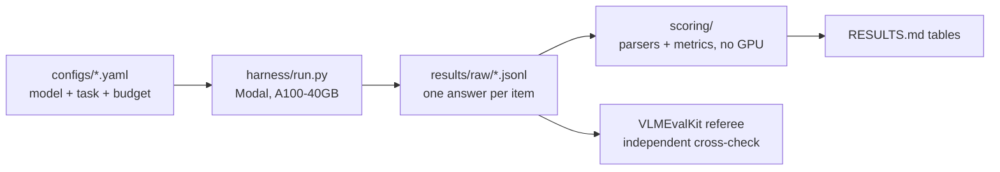

# Edge Vision-Language Model Evaluation

A reproducible benchmark of six small vision-language models on finding objects, yes/no questions about an image, and counting, measuring accuracy, speed, and how often each model's answer can be read at all. A shared harness, parsers, and scoring code run every model the same way, so the differences in the results come from the models, not from prompts, parsing, or the evaluation.

## Key findings

- **The prompt convention matters more than model size for weak instruction-followers.** Adding the standard "Please answer yes or no." to the POPE question lifts SmolVLM2 500M from 55.0% to 85.1% accuracy, on the same 9,000 items with the same parser.
- **The results match an independent referee.** Yes/no scores agree with VLMEvalKit's to within about half a point for the models checked (for example, SmolVLM2 85.1% vs. 85.6%).
- **Image detail trades accuracy for compute, but not speed, at 450M.** LFM2.5-VL 450M's object-finding accuracy rises from 39.5% at 32 image tokens to 77.5% at 256, while time per image stays near 500 ms.
- **A crash was found, traced, and fixed in the open.** Forcing a fixed image-token budget crashed the shipped LFM stack on up to 14% of images and first made accuracy look like it fell at 256 tokens. The root cause was traced to rounding in the model's own resize code. A disclosed workaround recovered every image, and the earlier run is kept as the record of the crash.

Full tables: [RESULTS.md](RESULTS.md). Controls, limitations, and every change: [METHODOLOGY.md](METHODOLOGY.md).

## Engineering highlights

- **Config-driven harness.** One YAML file per model and task. One runner serves both the main benchmark and the image-detail sweep.
- **Inference and scoring are separate stages.** The GPU stage writes raw per-item answers with full provenance (model revision, library versions, device, prompt). Scoring reads only those files and needs no GPU.
- **Model-specific output parsers with unit tests**, and a parse rate reported next to every score.
- **Controlled runs.** Greedy decoding, one GPU type asserted inside the container, everything pinned by hash, and resume-by-item so a lost container never loses finished work.
- **Failures are reported as findings,** never quietly retried or dropped.

## Check it yourself

Re-score any stored result from the raw answers on a laptop, with the Python standard library only:

```bash
python3 -m scoring.score results/raw/bench_suffixed/bench_suffixed_smolvlm2_pope.jsonl --out /tmp/rescore
# -> accuracy 0.8508 over 9,000 items (RESULTS.md: 85.1%)
```

Rerunning a model needs a [Modal](https://modal.com) account and runs on an A100-40GB:

```bash
modal run harness/run.py --config configs/bench/lfm450m_grounding.yaml
```

## How it fits together



## A design decision worth noting

Each model is measured in two separate ways that are never mixed. The main table runs every model at full precision on the same GPU, so the models can be compared fairly. A separate table measures two models in the small form they actually ship in, on a CPU, because that is how they would be deployed. Merging the two would have looked tidier, but it would have mixed differences between models with differences between hardware and precision.

---

## Project overview

One project, two parts, one shared harness. All inference runs on **Modal**; the local
machine is a control plane only (no GPU, no model loads, no dataset image processing).

- **Part 1 — Main benchmark**: six small vision-language models × three public benchmarks
  (RefCOCO-M grounding, POPE, CountBenchQA), bf16, greedy decoding, single GPU type
  (A100-40GB), fully pinned. Plus a strictly separate **deployed-form table**:
  Moondream 0.5B as-shipped in its own runtime, and LFM2.5-VL-450M quantized to its
  shipped small form, on the same items — never merged into the bf16 main table.
- **Part 2 — Image-token-budget sweep**: grounding accuracy and latency vs. image-token
  budget for three small VLMs (LFM2.5-VL-450M, SmolVLM2-500M, Moondream 0.5B) on
  RefCOCO-M, producing an accuracy-vs-budget curve and a demo-consumable lookup table.

Both parts share one config-driven harness, one set of parsers/prompts/scoring, and the
same Modal Images, so differences in results come from models and settings — not from
harness divergence.

## Status

Complete. Results for both parts are in [RESULTS.md](RESULTS.md), with a raw per-item answer file behind every number under `results/raw/`. Published numbers appear only in the calibration table, with live source URLs.

## Repo map

```
README.md          # this file: setup, repo map, one-command repro per cell
METHODOLOGY.md     # full spec, pins, findings, change log (Part 1 & Part 2 sections)
RESULTS.md         # tables only, no narrative (Part 1 & Part 2 sections)
configs/
  bench/           # Part 1: one YAML per (model, task) cell
  sweep/           # Part 2: one YAML per (model, budget) cell
envs/              # Modal Image definitions + exported lockfiles per env
harness/           # inference runners (Modal functions) — shared by both parts
prompts/           # verbatim prompt templates, one file per template id
parsers/           # per-model output parsers + unit tests
scoring/           # scoring pass over raw JSONL only, no GPU needed
results/
  raw/{bench,sweep}/      # per-item JSONL, one file per cell
  tables/{bench,sweep}/   # generated CSV/JSON + markdown tables
calibration/       # Part 1: published-vs-ours table, VLMEvalKit lane outputs
demo_data/         # Part 2: demo-consumable lookup table (schema note below, TBD)
liquid-ai-learning/ # Liquid AI study guide, prep course and EDGE RUSH game (see below)
```

## Liquid AI learning materials

`liquid-ai-learning/` is separate from the benchmark. It holds three earlier study projects about Liquid AI, each a single HTML file you open in a browser:

- `study-guide/`: a long-form guide to Liquid AI's technology, market, company and competition.
- `prep-course/`: the same material as 97 short lessons with progress tracking.
- `edge-rush-game/`: EDGE RUSH, a browser game that teaches how on-device AI works.

They were moved here from their own repositories with their full commit history. See `liquid-ai-learning/README.md`.

## Setup (control plane)

```bash
python3.12 -m venv .venv
source .venv/bin/activate
pip install modal pyyaml          # in-container environments are pinned in envs/locks/
modal token set                    # or use an existing ~/.modal.toml
```

## Reproducing a cell

One command per cell, run from the repository root:

```bash
modal run harness/run.py --config configs/bench/lfm450m_grounding.yaml
modal run harness/run.py --config configs/bench/lfm450m_grounding.yaml --sample-n 20 --sample-seed 7   # quick sample
```

Score raw answers without a GPU:

```bash
python3 -m scoring.score results/raw/bench/<cell>.jsonl --out results/tables/bench/
```

## Provenance rules (non-negotiable)

- Every reported number comes from execution in this project.
- Everything pinned by hash: checkpoints, remote code, datasets, VLMEvalKit commit, envs.
- Freeze before scale; any post-freeze change re-runs affected cells and is logged in
  METHODOLOGY.md.
- Failures are findings: documented and reported, never silently patched or dropped.
