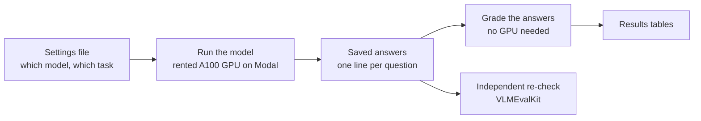

# Edge Vision-Language Model Evaluation

This project tests six small AI models that can look at a picture and answer questions about it. They are the kind of model small enough to run on a phone or a laptop rather than in a data center. Every model gets the same three tasks:

- **Find an object.** Draw a box around the thing a sentence describes, such as "the dog on the left." 2,080 examples from the RefCOCO-M dataset.
- **Answer yes or no.** Say whether an object is in the picture, such as "Is there a car in the image?" 9,000 questions from the POPE dataset.
- **Count.** Say how many of something there are. 491 questions from the CountBenchQA dataset.

For each model, the project records how often it is right, how long it takes per picture, and how often its answer comes back in a form that can be scored at all. Every model runs through the same code with the same settings. So when two models score differently, it is because the models differ, not because one was asked or graded differently.

## What it found

- **How the question is worded can matter more than which model is used.** Asked only "Is there a car in the image?", SmolVLM2 500M was right 55.0% of the time, often because it rambled instead of answering. Adding the standard instruction "Please answer yes or no." raised it to 85.1% on the same 9,000 questions.
- **The scores match an outside check.** The same models were scored a second time with VLMEvalKit, a widely used independent evaluation tool. The yes/no scores agreed within about half a percentage point (for SmolVLM2, 85.1% here and 85.6% there).
- **Letting LFM2.5-VL 450M see more detail roughly doubles its accuracy without slowing it down.** The model breaks each picture into small pieces called image tokens before reading it. With 32 tokens it found the right object 39.5% of the time; with 256 tokens, 77.5% of the time. It took about half a second per picture either way.
- **A crash was found, explained, and fixed in the open.** Fixing LFM's number of image tokens made the model's own software crash on up to 14% of pictures, which at first made the highest setting look worse than it was. The cause: when a small picture had to be enlarged to reach the set number, the model's resizing code rounded both sides up, went over its own limit, and crashed. Enlarging those pictures slightly beforehand sends them through the code's shrinking step instead, which rounds down and is safe. Every picture then completed. The earlier run that crashed is kept as a record.

Full tables are in [RESULTS.md](RESULTS.md). How each test was controlled, what the limits are, and every change made along the way are in [METHODOLOGY.md](METHODOLOGY.md).

## How it is built

- **One short settings file per test.** Each combination of model and task (and detail level) is a small YAML file, and one program runs them all.
- **Answering and grading are separate steps.** First, the models answer every question on a rented GPU (the kind of chip AI models run on), and every answer is saved along with exactly which model version, software versions, hardware, and prompt produced it. Grading then reads only those saved answers, so anyone can re-grade them on an ordinary laptop.
- **A tested answer reader for each model.** Models format their answers differently; a box might come back as four numbers or as a sentence. A small reader for each model turns its answers into something that can be graded, each reader has its own tests, and the share of answers it could read is reported next to every score.
- **The same conditions every time.** Models always give their single most likely answer, with no randomness. Every run checks that it is on the same kind of GPU (an Nvidia A100 with 40 GB of memory) and refuses to run otherwise. Model and dataset versions are pinned to an exact fingerprint. A run that is interrupted picks up where it left off without losing any answers.
- **Failures are reported, not hidden.** A wrong or unreadable answer counts as a result. It is never quietly retried or dropped.

## Check it yourself

Re-grade a stored result on any computer with Python. No GPU or extra packages are needed:

```bash
python3 -m scoring.score results/raw/bench_suffixed/bench_suffixed_smolvlm2_pope.jsonl --out /tmp/rescore
# writes a report showing accuracy 0.8508 over 9,000 questions (RESULTS.md: 85.1%)
```

Running a model again needs an account with [Modal](https://modal.com), a service that rents out GPUs by the second:

```bash
modal run harness/run.py --config configs/bench/lfm450m_grounding.yaml
```

## How the pieces connect



## A design decision worth noting

The models are compared in two separate tables that are never combined. The main table runs every model uncompressed, at full quality, on the same GPU, so the comparison is fair. A second table runs two of the models the way they are actually shipped to devices: compressed to a smaller size and running on an ordinary processor. Putting both in one table would look neater, but then a difference in score could come from the model, the hardware, or the compression, with no way to tell which.

---

## Project overview

One project, two parts, one shared harness. All inference runs on **Modal**; the local
machine is a control plane only (no GPU, no model loads, no dataset image processing).

- **Part 1 — Main benchmark**: six small vision-language models × three public benchmarks
  (RefCOCO-M grounding, POPE, CountBenchQA), bf16, greedy decoding, single GPU type
  (A100-40GB), fully pinned. Plus a strictly separate **deployed-form table**:
  Moondream 0.5B as-shipped in its own runtime, and LFM2.5-VL-450M quantized to its
  shipped small form, on the same items — never merged into the bf16 main table.
- **Part 2 — Image-token-budget sweep**: grounding accuracy and latency vs. image-token
  budget for three small VLMs (LFM2.5-VL-450M, SmolVLM2-500M, Moondream 0.5B) on
  RefCOCO-M, producing an accuracy-vs-budget curve and a demo-consumable lookup table.

Both parts share one config-driven harness, one set of parsers/prompts/scoring, and the
same Modal Images, so differences in results come from models and settings — not from
harness divergence.

## Status

Complete. Results for both parts are in [RESULTS.md](RESULTS.md), with a raw per-item answer file behind every number under `results/raw/`. Published numbers appear only in the calibration table, with live source URLs.

## Repo map

```
README.md          # this file: setup, repo map, one-command repro per cell
METHODOLOGY.md     # full spec, pins, findings, change log (Part 1 & Part 2 sections)
RESULTS.md         # tables only, no narrative (Part 1 & Part 2 sections)
configs/
  bench/           # Part 1: one YAML per (model, task) cell
  sweep/           # Part 2: one YAML per (model, budget) cell
envs/              # Modal Image definitions + exported lockfiles per env
harness/           # inference runners (Modal functions) — shared by both parts
prompts/           # verbatim prompt templates, one file per template id
parsers/           # per-model output parsers + unit tests
scoring/           # scoring pass over raw JSONL only, no GPU needed
results/
  raw/{bench,sweep}/      # per-item JSONL, one file per cell
  tables/{bench,sweep}/   # generated CSV/JSON + markdown tables
calibration/       # Part 1: published-vs-ours table, VLMEvalKit lane outputs
demo_data/         # Part 2: demo-consumable lookup table (schema note below, TBD)
liquid-ai-learning/ # Liquid AI study guide, prep course and EDGE RUSH game (see below)
```

## Liquid AI learning materials

`liquid-ai-learning/` is separate from the benchmark. It holds three earlier study projects about Liquid AI, each a single HTML file you open in a browser:

- `study-guide/`: a long-form guide to Liquid AI's technology, market, company and competition.
- `prep-course/`: the same material as 97 short lessons with progress tracking.
- `edge-rush-game/`: EDGE RUSH, a browser game that teaches how on-device AI works.

They were moved here from their own repositories with their full commit history. See `liquid-ai-learning/README.md`.

## Setup (control plane)

```bash
python3.12 -m venv .venv
source .venv/bin/activate
pip install modal pyyaml          # in-container environments are pinned in envs/locks/
modal token set                    # or use an existing ~/.modal.toml
```

## Reproducing a cell

One command per cell, run from the repository root:

```bash
modal run harness/run.py --config configs/bench/lfm450m_grounding.yaml
modal run harness/run.py --config configs/bench/lfm450m_grounding.yaml --sample-n 20 --sample-seed 7   # quick sample
```

Score raw answers without a GPU:

```bash
python3 -m scoring.score results/raw/bench/<cell>.jsonl --out results/tables/bench/
```

## Provenance rules (non-negotiable)

- Every reported number comes from execution in this project.
- Everything pinned by hash: checkpoints, remote code, datasets, VLMEvalKit commit, envs.
- Freeze before scale; any post-freeze change re-runs affected cells and is logged in
  METHODOLOGY.md.
- Failures are findings: documented and reported, never silently patched or dropped.
