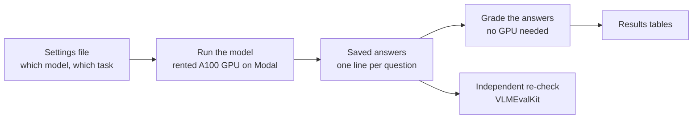

# Edge Vision-Language Model Evaluation

This project tests six small AI models that can look at a picture and answer questions about it. They are small enough to run on a phone or a laptop. Every model gets the same three tasks:

- **Find an object.** Draw a box around the thing a sentence describes, such as "the dog on the left." 2,080 examples from the RefCOCO-M dataset.
- **Answer yes or no.** Say whether an object is in the picture, such as "Is there a car in the image?" 9,000 questions from the POPE dataset.
- **Count.** Say how many of something there are. 491 questions from the CountBenchQA dataset.

For each model, the project records how often it is right, how long it takes per picture, and how often its answer comes back in a form that can be scored at all. Every model runs through the same code on the same kind of GPU with the same decoding settings. The one thing that differs per model is the wording of the find-object request, because each model was trained to be asked in its own format (see "How the tests were run").

## What we did

1. **Compared six small models on three tasks** (find, yes/no, count), all at full precision on the same kind of GPU, with the same settings and the same grading code.
2. **Checked our grading against an independent tool** (VLMEvalKit) on the models it supports. One place used different question wording from the community standard, and we fixed it.
3. **Turned the image-detail dial** on two models (how many image tokens each picture is broken into) and measured accuracy, speed and electricity at every setting.
4. **Ran the models the way they ship.** Moondream 0.5B only exists in one compressed form. We ran it next to LFM2.5-VL 450M's vendor-compressed version, both on an ordinary processor, in a separate table.

## What it found

**The headline: LFM2.5-VL 450M finds objects as accurately as moondream2, a model about four times its size.** moondream2 is faster at it, and LFM is more energy-efficient than SmolVLM2 (details below).

- **LFM2.5-VL 450M ties moondream2 (1.9B parameters) at finding objects.** The scores are 76.9% and 76.4% on 2,080 examples. Resampling the examples puts the difference between about -1.7 and +2.6 points, so it is inside the noise. LFM takes about 0.7 s per picture and moondream2 about 0.2 s. LFM's vendor-shipped Q8 version scores exactly the same 76.9%.
- **Image detail is nearly free for LFM on this task.** Going from 32 to 256 image tokens roughly doubles accuracy (39.5% to 77.5%). Time per picture stays at about half a second and energy stays between 3.5 and 4.2 joules per answer. SmolVLM2 behaves differently. Its detail dial multiplies energy 5.3 times and moves accuracy by an amount within noise. At its shipped defaults SmolVLM2 uses 11 to 13 times the energy of LFM per answer, and about 15 times per correct answer. Those figures come from the same 100 counting questions, so treat the ratio as approximate.
- **Small targets are the weak spot.** LFM finds 89% of large targets and 73% of medium ones. It finds only 44% of tiny ones (under 5% of the picture). Just 46 examples are tiny, so treat this as a pattern to check. Qwen2.5-VL 7B stays at 80% on tiny targets. moondream2 scores 78% on tiny targets and 74% on medium ones.
- **Counting gets harder as the number grows.** On the 223 questions whose true answer is 7 or more, Qwen2.5-VL 7B gets 79% right, moondream2 73%, LFM 49%, SmolVLM2 45% and InternVL3.5 1B 32%. InternVL3.5 1B and SmolVLM2 are most often off by exactly one (25% and 23% of answers). Off-by-one is the typical miscounting error. We have not checked the rest of the wrong answers.
- **"Is it there?" questions get harder when the wrong object is plausible.** POPE has an easy, a medium and a hard version. Every model scores best on random objects and worst on adversarial ones, which often appear alongside what is really in the picture. InternVL3.5 1B falls from 92.8% to 81.1% and answers "yes" 62% of the time on the hard set. Qwen2.5-VL 7B falls least (89.1% to 87.0%) and says "yes" 40 to 42% of the time on all three versions.
- **Accuracy and speed rank the models differently.** LFM is the fastest at counting (40 ms per question) and fourth on accuracy. moondream2 is the fastest at finding objects (203 ms) and the best at yes/no. Qwen2.5-VL 7B is the most accurate at finding and counting and takes about 1.2 s per picture to find an object. No model leads all three tasks.
- **Question wording moved one model by 30 points.** Asked only "Is there a car in the image?", SmolVLM2 500M was right 55.0% of the time. It often rambled instead of answering. Adding the standard instruction "Please answer yes or no." raised it to 85.1% on the same 9,000 questions.
- **The scores match an outside check, with one open disagreement.** The yes/no scores agree with VLMEvalKit within about half a percentage point (SmolVLM2 scores 85.1% here and 85.6% there). On counting, our grader credits more answers than the tool does for two models. LLaVA-OV scores 73.1% here and 31.6% there. The question text is byte-identical in both, so the difference lies in how answers are read. We list it as open.
- **Compressing LFM costs almost nothing, and Moondream 0.5B has no other form.** In the shipped-form table LFM 450M Q8 scores 76.9% / 85.3% / 69.7% (find / yes-no / count). Moondream 0.5B scores 21.3% / 55.1% / 31.6%. This table is separate from the main one and the two cannot be compared.
- **A crash in the model's own software.** Fixing LFM's number of image tokens made the model's own software crash on up to 14% of pictures, which at first made the highest setting look worse than it was. When a small picture had to be enlarged to reach the set number, the model's resizing code rounded both sides up, went over its own limit and crashed. Enlarging those pictures slightly beforehand sends them through the code's shrinking step, which rounds down and is safe. Every picture then completed. The earlier run that crashed is kept as a record.

The size, category and counting breakdowns, and 95% confidence intervals for every headline score, are generated by `python3 -m scoring.breakdowns` from the saved answers and listed in [RESULTS.md](RESULTS.md).

Full tables are in [RESULTS.md](RESULTS.md). How each test was controlled, what the limits are, and every change made along the way are in [METHODOLOGY.md](METHODOLOGY.md).

## How the tests were run

The choices below determine what the numbers mean.

- **What "found" means.** A find-object answer is a box. It counts as correct when it overlaps the true box by at least half (intersection over union of 0.5 or more, written Acc@0.5). An answer that cannot be read as a box counts as a miss.
- **Each model is asked in its own format.** Yes/no and counting use one shared wording. Find-object cannot, because models were trained on different box formats: LFM returns JSON with 0 to 1 coordinates, Qwen returns pixel coordinates, InternVL uses tagged 0 to 1000 coordinates, and moondream2 has a built-in detect function. We used each model's documented format. SmolVLM2 and LLaVA-OV document none, so we tried a best-effort prompt. SmolVLM2's 0.0% means it does not produce boxes. A separate probe at matched image-token counts showed that more detail cannot change that.
- **Yes/no follows the community prompt.** We first asked the bare question, saw the 30-point drop for SmolVLM2, then reran every model with the "Please answer yes or no." suffix that the standard tooling uses. Both runs are kept.
- **No sampling.** Models always take their most likely next word, so a rerun gives the same answers. Precision is bf16 (16-bit numbers), the usual full-quality setting. moondream2 exposes no sampling controls, and its defaults are used.
- **Why a custom harness.** It has no adapter for LFM and no RefCOCO-M dataset, so it cannot run the main comparison. We built one harness for all six models and used VLMEvalKit as a second opinion on the models and tests it covers.
- **One RefCOCO-M expression per object.** Each object has one to three descriptions. We use the first, which gives 2,080 examples from 1,190 images.
- **The image-detail sweep changes one thing at a time.** For LFM, minimum and maximum image tokens are set equal and tiling is turned off, so the token count is the only variable. SmolVLM2 has no token setting. Its dial is input resolution, so it was swept on counting (a task it can do) and is never plotted on LFM's find-object curve. Moondream 0.5B has no dial, so it appears at a single point.
- **Energy is measured.** It is read from the GPU's own energy counter while the model answers, with model loading excluded. A second figure subtracts each run's idle power. The 100 counting questions are the ones every setting completed, which is why the energy comparison is limited to that subset.
- **The shipped-form comparison is unequal by necessity.** Moondream 0.5B only exists in compressed form. For LFM we picked its vendor-published Q8 version to match Moondream's 8-bit precision. LFM can be compared with its own full-precision score. Moondream 0.5B has no full-precision version to compare with.
- **Changes are logged.** METHODOLOGY.md has a numbered change log, and the raw files from superseded runs are kept.

## How it is built

- **One short settings file per test.** Each combination of model and task (and detail level) is a small YAML file, and one program runs them all.
- **Answering and grading are separate steps.** First, the models answer every question on a rented GPU (the kind of chip AI models run on), and every answer is saved along with exactly which model version, software versions, hardware, and prompt produced it. Grading then reads only those saved answers, so anyone can re-grade them on an ordinary laptop.
- **A tested answer reader for each model.** Models format their answers differently; a box might come back as four numbers or as a sentence. A small reader for each model turns its answers into something that can be graded, each reader has its own tests, and the share of answers it could read is reported next to every score.
- **The same conditions every time.** Models always give their single most likely answer, with no randomness. Every run checks that it is on the same kind of GPU (an Nvidia A100 with 40 GB of memory) and refuses to run otherwise. Model and dataset versions are pinned to an exact fingerprint. A run that is interrupted picks up where it left off without losing any answers.
- **Failures stay in the data.** A wrong or unreadable answer counts against the model. Nothing is retried or dropped without a note in METHODOLOGY.md.

## Check it yourself

Re-grade a stored result on any computer with Python. No GPU or extra packages are needed:

```bash
python3 -m scoring.score results/raw/bench_suffixed/bench_suffixed_smolvlm2_pope.jsonl --out /tmp/rescore
# writes a report showing accuracy 0.8508 over 9,000 questions (RESULTS.md: 85.1%)
```

Running a model again needs an account with [Modal](https://modal.com), a service that rents out GPUs by the second:

```bash
modal run harness/run.py --config configs/bench/lfm450m_grounding.yaml
```

## How the pieces connect



## Why the shipped-form table is separate

The models are compared in two separate tables that are never combined. The main table runs every model uncompressed, at full quality, on the same GPU, so the comparison is fair. A second table runs two of the models the way they are actually shipped to devices: compressed to a smaller size and running on an ordinary processor. A combined table would hide whether a score gap came from the model, the hardware or the compression.

---

## Project overview

One project, two parts, one shared harness. All inference runs on **Modal**; the local
machine is a control plane only (no GPU, no model loads, no dataset image processing).

- **Part 1 — Main benchmark**: six small vision-language models × three public benchmarks
  (RefCOCO-M grounding, POPE, CountBenchQA), bf16, greedy decoding, single GPU type
  (A100-40GB), fully pinned. Plus a strictly separate **deployed-form table**:
  Moondream 0.5B as-shipped in its own runtime, and LFM2.5-VL-450M quantized to its
  shipped small form, on the same items — never merged into the bf16 main table.
- **Part 2 — Image-token-budget sweep**: grounding accuracy and latency vs. image-token
  budget for three small VLMs (LFM2.5-VL-450M, SmolVLM2-500M, Moondream 0.5B) on
  RefCOCO-M, producing an accuracy-vs-budget curve and a demo-consumable lookup table.

Both parts share one config-driven harness, one set of parsers/prompts/scoring, and the
same Modal Images, so differences in results come from the models and settings.

## Status

Complete. Results for both parts are in [RESULTS.md](RESULTS.md), with a raw per-item answer file behind every number under `results/raw/`. Published numbers appear only in the calibration table, with live source URLs.

## Repo map

```
README.md          # this file: setup, repo map, one-command repro per cell
METHODOLOGY.md     # full spec, pins, findings, change log (Part 1 & Part 2 sections)
RESULTS.md         # tables only, no narrative (Part 1 & Part 2 sections)
configs/
  bench/           # Part 1: one YAML per (model, task) cell
  sweep/           # Part 2: one YAML per (model, budget) cell
envs/              # Modal Image definitions + exported lockfiles per env
harness/           # inference runners (Modal functions) — shared by both parts
prompts/           # verbatim prompt templates, one file per template id
parsers/           # per-model output parsers + unit tests
scoring/           # scoring pass over raw JSONL only, no GPU needed; breakdowns.py makes the CIs and breakdowns
results/
  raw/{bench,sweep}/      # per-item JSONL, one file per cell
  tables/{bench,sweep}/   # generated CSV/JSON + markdown tables
calibration/       # Part 1: published-vs-ours table, VLMEvalKit lane outputs
demo_data/         # Part 2: demo-consumable lookup table (schema note below, TBD)
```

## Setup (control plane)

```bash
python3.12 -m venv .venv
source .venv/bin/activate
pip install modal pyyaml          # in-container environments are pinned in envs/locks/
modal token set                    # or use an existing ~/.modal.toml
```

## Reproducing a cell

One command per cell, run from the repository root:

```bash
modal run harness/run.py --config configs/bench/lfm450m_grounding.yaml
modal run harness/run.py --config configs/bench/lfm450m_grounding.yaml --sample-n 20 --sample-seed 7   # quick sample
```

Score raw answers without a GPU:

```bash
python3 -m scoring.score results/raw/bench/<cell>.jsonl --out results/tables/bench/
```

## Provenance rules (non-negotiable)

- Every reported number comes from execution in this project.
- Everything pinned by hash: checkpoints, remote code, datasets, VLMEvalKit commit, envs.
- Freeze before scale; any post-freeze change re-runs affected cells and is logged in
  METHODOLOGY.md.
- Failures are findings: documented and reported, never silently patched or dropped.
